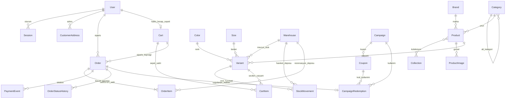

# Quantia backend mimarisi

Backend TypeScript ve Express.js üzerinde çalışır. PostgreSQL 17 ve Redis ayrı Docker servisleridir. Prisma 7.10.1 şeması, migration dosyaları ve kilitlenmiş npm bağımlılıkları kaynak koduyla tutulur.

Prisma şeması 29 ilişkisel model içerir; kullanıcı, sepet, ürün, varyant, renk, beden, kategori, koleksiyon, kampanya, kupon, depo, stok hareketi, sipariş, ödeme olayı ve yönetim ayarları ayrı modellerdir.

## Klasörlerin sorumlulukları

```text
backend/
  prisma/
    migrations/                 # Sürümlü SQL ve veritabanı kısıtları
    schema.prisma               # İlişkisel veri modeli
    fixtures.ts                 # Tekrarlanabilir örnek katalog
    seed.ts                     # Güvenli başlangıç yüklemesi
  scripts/
    prepare-tests.mjs           # Test veritabanı koruması ve migration
    create-admin.mjs            # Docker içinde ilk yönetici oluşturma
  src/
    core/
      config/                   # Doğrulanmış ortam ve çerez ayarları
      prisma/                   # PostgreSQL bağlantısı
      redis/                    # Dağıtık hız sınırı
      queues/                   # Periyodik iş zamanlayıcısı
      sanitizer/                # Ortak girdi kuralları
    graphql/
      common.schema.ts          # Ortak GraphQL tipleri
      context.ts                # Oturum ve yetki bağlamı
      schema.ts                 # Modül şemalarının birleşimi
      security.ts               # Derinlik/alan/fragment kontrolleri
    jobs/
      worker.ts                 # Ödeme rezervasyonu ve oturum temizliği
    lib/
      crypto.ts                 # Scrypt, token özeti, AES-GCM
      errors.ts                 # Güvenli hata dönüşümleri
    modules/
      account/                  # Sahiplik kontrollü müşteri adresleri
      auth/                     # Üyelik, giriş, çıkış ve oturum
      campaigns/                # Kampanya, kupon ve fiyat hesapları
      carts/                    # Hesap/misafir sepeti, birleşim ve sürüm kontrolü
      catalog/                  # Ürün, görsel, kategori ve varyant
      dashboard/                # Yönetim özeti, denetim ve stok hareketi
      customers/                # Sayfalı müşteri listesi ve adres/sipariş ayrıntıları
      inventory/                # Depolar, stok sayımı ve transfer kayıtları
      marketing/                # İzinli aboneler ve imzalı ayrılma bağlantıları
      media/                    # Doğrulanan görsel yükleme ve metadata
      newsletter/               # Açık izinli abonelik kaydı
      orders/                   # Ayrı dosyalarda checkout/stok/ödeme/durum/sona erme
      payments/
        providers/              # iyzico, PayTR, Stripe ve havale adaptörleri
      reviews/                  # Google Places ve şifreli anahtar ayarları
      reports/                  # İstanbul saatine göre günlük tahsilat ve ürün analizi
      seo/                      # İndekslenebilir adresler ve yönlendirmeler
      settings/                 # Mağaza ve içerik ayarları
      taxonomy/                 # Renk, beden, marka ve koleksiyon sözlükleri
      users/                    # Yönetici oluşturma, yetki ve hesap durumu
    app.ts                      # Express uygulaması; sunucu başlatmaz
    server.ts                   # HTTP sunucusu ve kontrollü kapanış
  tests/                        # API, PostgreSQL ve sağlayıcı protokol testleri
```

Modülün `dto` dosyası girdiyi doğrular, `schema` API sözleşmesini tanımlar, `resolvers` isteği ilgili servise iletir, `service` yetki ve iş kurallarını uygular. Prisma sorgu şekilleri tekrar kullanılıyorsa `includes` dosyasına ayrılır. Sipariş servisleri tek büyük dosyada toplanmaz.

## Veri ilişkileri



## Ticari kurallar

- Para tam sayı kuruş, yüzdeler baz puan olarak saklanır. `1000` baz puan `%10` demektir. Fiyatlar vergi dahil toplam olarak değerlendirilir; oranlar işletme tarafından ürün ve kargo ayarlarında girilir. Örnek katalogda vergi oranı sıfırdır; bu bir mevzuat oranı önerisi değildir.
- Fiyat, indirim, kargo ve vergi sunucuda hesaplanır. İstemci sipariş toplamı gönderemez.
- Aynı siparişte tek kampanya uygulanır. Kupon verilmişse o kupon değerlendirilir; kupon yoksa uygun otomatik kampanyalardan en yüksek indirim seçilir. Kampanya hedefi üst kategori ise alt kategoriler de kapsanır.
- Kargo eşiği indirim sonrası ürün toplamına uygulanır. İndirim satırlara kuruş kaybı olmadan dağıtılır. Sağlayıcıya giden sepet de aynı net toplamı kullanır.
- Checkout sepeti kilitler, kupon kullanım hakkını kontrol eder, sipariş anındaki ürün bilgilerini kopyalar ve varyant stoğunu koşullu azaltır. Her adım aynı PostgreSQL transaction'ındadır.
- `cartId + idempotencyKey` benzersizdir. Tekrar gönderim yeni sipariş ya da yeni stok düşümü oluşturmaz.
- Ödeme beklerken stok rezervasyondadır. Kart için 30 dakika, havale için 24 saat beklenir. İşçi bu süreleri geçen siparişleri kapatır ve stoğu bir kere bırakır.
- Sağlayıcı ödeme oturumunu başlatamazsa rezervasyon kaldırılır; ürünler ve kupon aynı sepete geri eklenir. Bekleme sırasında eklenmiş diğer ürünler korunur. İstemci yalnızca bu kesin başarısızlık kodunda yeni sipariş anahtarı oluşturur; belirsiz ağ hatalarında aynı anahtarı koruyarak çift siparişi önler.
- Stok sürümü, eski yönetim formunun araya giren sipariş rezervasyonunu ezmesini engeller. Stok hareketleri ayrı geçmiş tablosunda kalır.
- Hesap sepeti `Cart.userId` benzersiz ilişkisiyle saklanır; misafir çerezinin süresinden bağımsızdır. Girişte misafir ürünleri hesap sepetine tek transaction içinde birleştirilir. Çıkış, hesaptaki ürünleri silmez. Aynı varyant için adet sınırı 10'dur; birleşimde bu sınıra göre birleştirilir.
- Sepet sürümü, geç yanıtın yeni ekran durumunu geri almasını ve eski sekmenin mutlak miktarla silinen ürünü geri getirmesini önler. Adet ekleme/azaltma sunucuda satır kilidi altında yapılır. Tarayıcı Web Locks ve BroadcastChannel desteğiyle istekleri sıralar ve sekmeleri eşler; odak dönüşünde sunucudan tekrar okur.
- Bir varyantın mevcut stoğu tek depoda tutulur. Depo değişiminde çıkış/giriş hareketleri kaydedilir. Açık siparişin rezervasyonu varken depo değişmez; stok veya rezervasyonu bulunan depo kapatılamaz. Pasif depoya stok yazılamaz.
- Kullanımdaki varyantlar fiziksel silinmez; pasife alınır. Sipariş satırları ürünün sonraki değişikliklerinden etkilenmez.
- Durum geçişleri sınırlıdır. Kart ödemesini yönetici elle onaylayamaz. Havale onayı bankadan kontrol edildikten sonra yönetici tarafından verilir.
- Tahsil edilmiş sipariş iptal edilirse `REFUND_REQUIRED` olur. Otomatik iade endpoint'i bu sürümün kapsamında değildir; sağlayıcı panelindeki iade tamamlanmadan para iade edilmiş sayılmaz.

## Mimari sınırlar

Her müşteriye bağımsız mağaza kurulumu hedeflenmiştir. Birden çok işletmenin tek veritabanını paylaştığı SaaS tenant izolasyonu bu sürümde yoktur.

Kampanya kullanımını kesinleştirmek için checkout sırasında etkin kampanya satırları sıralı kilitlenir. Bu küçük/orta ölçekli mağaza için tutarlı bir başlangıçtır. Yüksek sipariş hacminde kampanya bazlı rezervasyon servisine geçiş yük testiyle değerlendirilmelidir.

Nakit iade, e-fatura kesme, kargo etiketi üretme ve e-posta/SMS gönderme entegrasyonları ayrıca sağlayıcı sözleşmesi gerektirir. Şu an fatura bağlantısı, takip bilgisi ve abonelik kaydı yönetilir; dış sisteme belge ya da mesaj gönderilmez.
